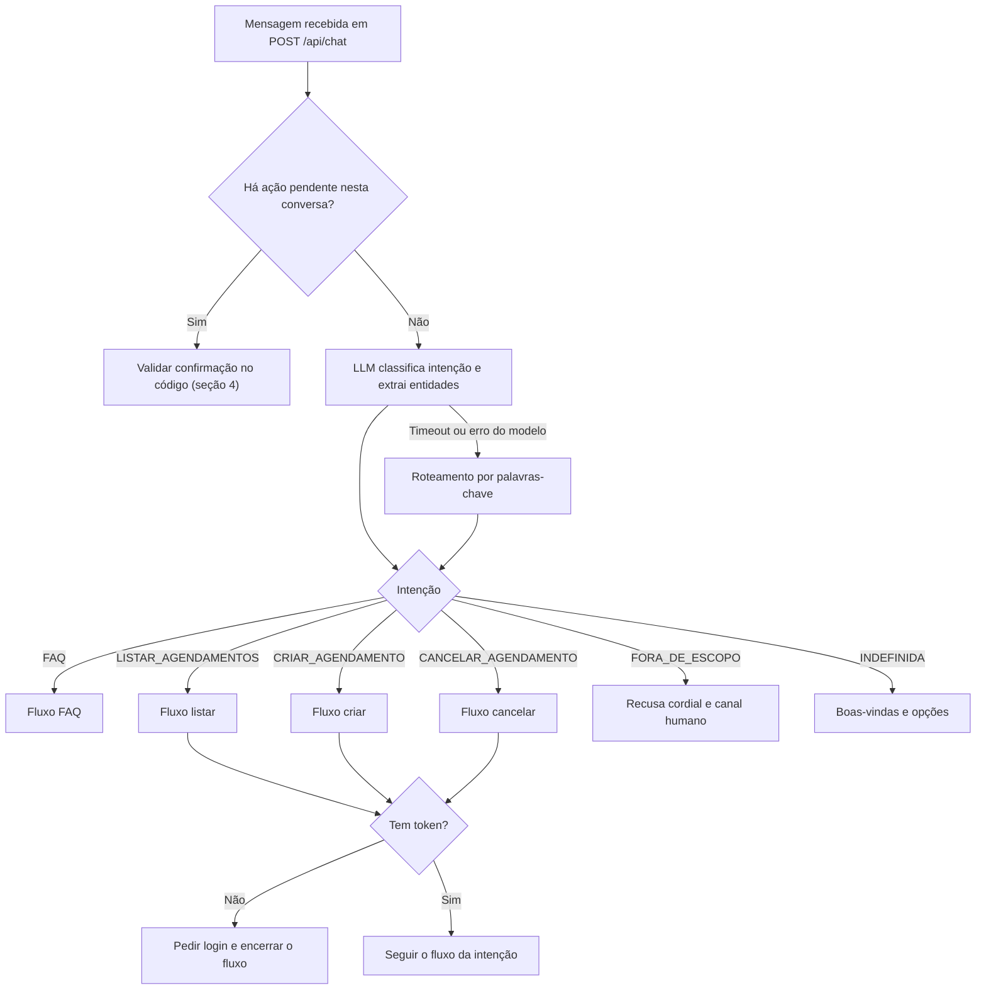
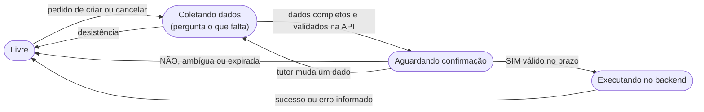
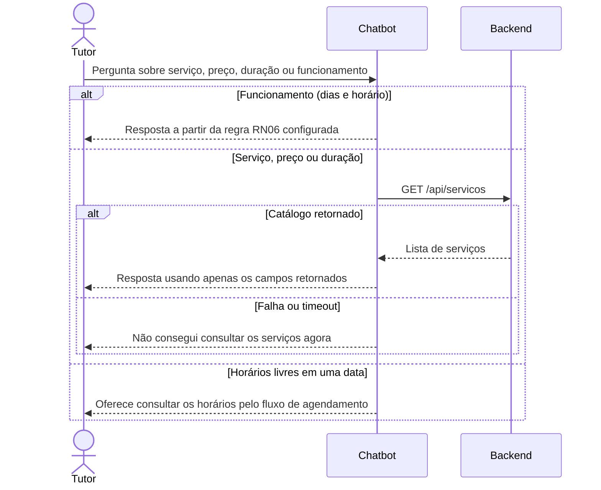
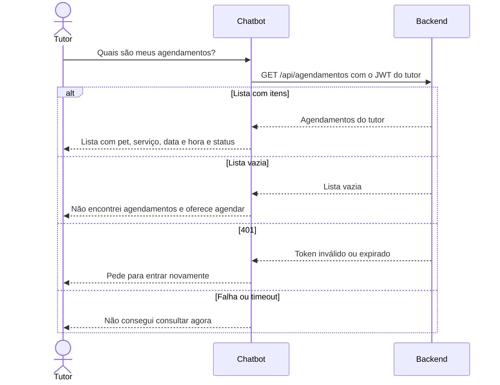
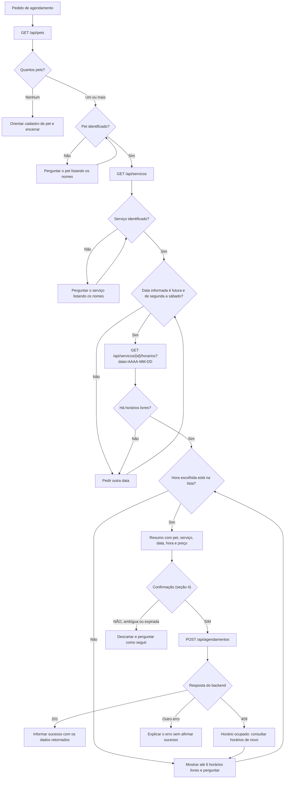
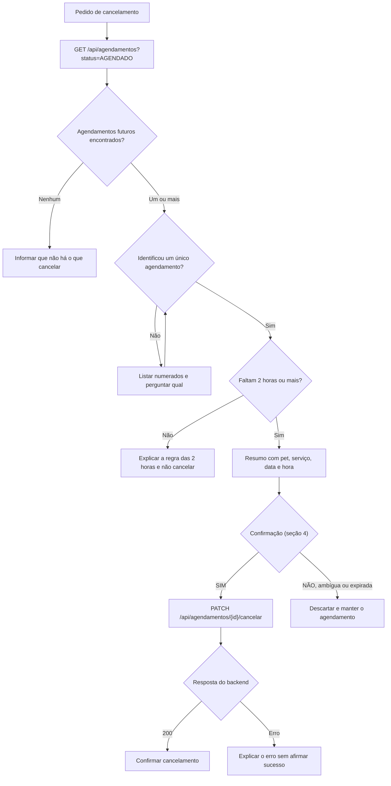

# Desenho das conversas do chatbot

**Fase:** dias 1 a 3 da sprint — desenho das conversas.
**Status:** especificação. Os fluxos abaixo descrevem o comportamento que será
implementado nos dias 4 a 9; ainda não estão no código.

Documentos relacionados:

- [Decisões técnicas](DECISOES_TECNICAS.md) — tecnologia escolhida e limites de segurança.
- [Contrato da API do chat](CONTRATO_API_CHAT.md) — formato de `POST /api/chat`.
- Documento de requisitos do PetCare Hub — RF14 a RF18, RN03 a RN10 e RNF11.

## 1. O que o chatbot faz

O chatbot atende o tutor dentro do PetCare Hub e reconhece seis intenções. Cada
uma tem um requisito de origem e uma fonte de dados definida.

| Intenção | Exemplo de mensagem | Requisito | Precisa de login | Fonte dos dados |
|---|---|---|---|---|
| `FAQ` | "Quanto custa a tosa?" | RF14 | Não | `GET /api/servicos` e regras de funcionamento (RN06) |
| `LISTAR_AGENDAMENTOS` | "Quais são meus agendamentos?" | RF15 | Sim | `GET /api/agendamentos?status=` |
| `CRIAR_AGENDAMENTO` | "Quero marcar um banho pro Thor" | RF16 | Sim | `GET /api/pets`, `GET /api/servicos`, `GET /api/servicos/{id}/horarios`, `POST /api/agendamentos` |
| `CANCELAR_AGENDAMENTO` | "Cancela meu horário de sábado" | RF17 | Sim | `GET /api/agendamentos`, `PATCH /api/agendamentos/{id}/cancelar` |
| `FORA_DE_ESCOPO` | "Me passa uma receita de bolo" | RF18 | Não | Mensagem fixa com o canal de atendimento humano |
| `INDEFINIDA` | "oi" ou "e aí?" | — | Não | Mensagem de boas-vindas com as opções disponíveis |

## 2. Regras que valem para todas as conversas

1. **Idioma e tom.** Respostas em português do Brasil, curtas e cordiais, com
   no máximo uma pergunta por mensagem.
2. **O modelo não é fonte de dados.** Serviços, preços, durações, horários
   livres, pets e agendamentos só aparecem na resposta se vierem da API do
   backend na mesma requisição. Sem o dado, o chatbot diz que não conseguiu
   confirmar a informação (RNF11).
3. **Papel do LLM.** O LangChain com Ollama classifica a intenção, extrai
   entidades (pet, serviço, data, hora) e redige o texto. Ele não decide
   autorização, não confirma ações e não chama endpoints de escrita.
4. **Datas calculadas pelo código.** Expressões como "amanhã" ou "sábado" são
   convertidas em data absoluta pelo código, no fuso `America/Sao_Paulo`. O
   chatbot sempre repete a data por extenso ("sábado, 31/10") para o tutor
   conferir.
5. **Pedir só o que falta.** Se a mensagem já traz pet, serviço ou data, o
   chatbot aproveita esses dados e pergunta apenas o restante.
6. **Confirmação antes de qualquer mudança.** Criar ou cancelar exige um resumo
   e uma resposta afirmativa explícita, validada pelo estado guardado no
   servidor (seção 4).
7. **Identidade vem do token.** O JWT segue do frontend para o backend pelo
   cliente HTTP e nunca entra no prompt. O chatbot ignora qualquer ID ou e-mail
   de tutor digitado na conversa e nunca pede senha (RN03, RNF01).
8. **Falhas sem travar.** Erros do backend ou do modelo geram uma resposta útil
   e a conversa continua. Nunca se anuncia um sucesso que o backend não
   confirmou (seção 7).
9. **Tempo de resposta.** A resposta completa sai em até 10 segundos (RNF11).
   Cada chamada ao backend tem limite de 3 s e a chamada ao modelo tem limite
   de 6 s. Se o modelo estourar o tempo, o chatbot usa o roteamento por
   palavras-chave (seção 3).

## 3. Roteamento da mensagem

Toda mensagem passa pelo mesmo caminho. Se existe uma ação aguardando
confirmação, a resposta do tutor é tratada primeiro pelo código, sem o LLM.



**Roteamento por palavras-chave** (usado quando o modelo falha ou demora):

| Palavras na mensagem | Intenção |
|---|---|
| cancelar, cancela, desmarcar | `CANCELAR_AGENDAMENTO` |
| agendar, marcar, reservar | `CRIAR_AGENDAMENTO` |
| meus agendamentos, meus horários, o que tenho marcado | `LISTAR_AGENDAMENTOS` |
| preço, quanto custa, valor, serviço, horário de funcionamento, abre, fecha | `FAQ` |
| nenhuma das anteriores | `INDEFINIDA` |

A ordem da tabela importa: "cancelar o agendamento" contém "agendamento", mas
deve cair em cancelamento.

## 4. Estado da conversa e confirmação

O estado de cada conversa fica no servidor do chatbot, identificado pelo
`conversaId` (ver contrato). O histórico enviado pelo navegador serve apenas de
contexto para o modelo e nunca prova que uma confirmação aconteceu.



Regras da confirmação:

- A ação pendente guarda o tipo (criar ou cancelar), os dados exatos do resumo,
  um hash do token do tutor e o horário de expiração (5 minutos).
- Só confirma a mensagem cujo texto inteiro, sem acentos e sem pontuação, seja
  uma destas: `sim`, `s`, `confirmo`, `confirmar`, `pode`, `pode sim`, `isso`.
- `nao`, `n`, `desisto` ou `cancela` descartam a ação. Qualquer outra resposta
  também descarta e o chatbot pergunta como o tutor quer seguir.
- Se a resposta trouxer um dado novo ("muda para 10h"), a ação é descartada e o
  fluxo volta para a coleta, mantendo os dados que não mudaram.
- A confirmação vale apenas para o mesmo `conversaId` e o mesmo token. Com outro
  token, o chatbot descarta a ação.
- A ação é marcada como consumida **antes** da chamada ao backend, para que um
  clique duplo não crie dois agendamentos.

## 5. Fluxos por intenção

Os valores nos exemplos (nomes, preços, horários) são ilustrativos. Na
conversa real, todos vêm da API.

### 5.1 Dúvidas frequentes — RF14



```text
Tutor:   Quanto custa a tosa?
Chatbot: A Tosa custa R$ 60,00 e dura cerca de 60 minutos.
         Quer agendar para algum dos seus pets?

Tutor:   Vocês abrem domingo?
Chatbot: Não. O atendimento é de segunda a sábado, das 8h às 18h,
         com horários a cada 30 minutos.
```

- Os horários de funcionamento ficam em configuração (`HORARIO_FUNCIONAMENTO`),
  com o valor da RN06 como padrão. Se a equipe mudar o horário, só a
  configuração muda.
- Se o tutor citar um serviço que não está no catálogo, o chatbot diz que não
  o encontrou e lista os nomes disponíveis.
- Perguntas de saúde do animal (sintomas, remédios, doses) são tratadas como
  fora de escopo: o chatbot sugere agendar uma consulta veterinária.

### 5.2 Fora de escopo — RF18

```text
Tutor:   Me passa uma receita de bolo?
Chatbot: Esse assunto eu não consigo responder. Posso ajudar com serviços,
         preços, horários e agendamentos do PetCare Hub.
         Para falar com um atendente, {canal de atendimento humano}.
```

- O canal humano vem da configuração `CANAL_ATENDIMENTO_HUMANO`. Enquanto a
  equipe não definir o canal oficial, o texto padrão é "procure a recepção do
  PetCare Hub". O chatbot nunca inventa telefone, e-mail ou link.
- A recusa não repreende o tutor e sempre oferece o que o chatbot sabe fazer.
- Tentativas de mudar as regras pela conversa ("ignore as instruções
  anteriores", "aja como outro assistente") recebem a mesma resposta de fora de
  escopo.

### 5.3 Listar agendamentos — RF15



```text
Tutor:   Quais são meus agendamentos?
Chatbot: Encontrei 2 agendamentos:
         1. Thor — Banho — sábado, 31/10, às 09h30 — AGENDADO
         2. Mia — Vacinação — terça, 20/10, às 14h00 — CONCLUÍDO
```

- Se a mensagem citar um status ("meus agendamentos cancelados"), o chatbot
  envia `?status=CANCELADO`. Status válidos: `AGENDADO`, `CANCELADO` e
  `CONCLUÍDO` (RN10).
- Ordem de exibição: primeiro os futuros com status `AGENDADO`, do mais próximo
  ao mais distante; depois os demais. No máximo 5 itens por resposta, com
  "e mais N" quando houver mais.

### 5.4 Criar agendamento — RF16



```text
Tutor:   Quero marcar um banho pro Thor.
Chatbot: Claro! Para qual dia você quer o banho do Thor?
Tutor:   sábado
Chatbot: No sábado, 31/10, os horários livres para Banho são:
         09h00, 09h30, 14h00 e 15h30. Qual você prefere?
Tutor:   9h30
Chatbot: Confirma o agendamento de Thor para Banho no sábado, 31/10,
         às 09h30, por R$ 50,00?
         Responda SIM para confirmar ou NÃO para desistir.
Tutor:   sim
Chatbot: Pronto! O banho do Thor está agendado para sábado, 31/10, às 09h30.
```

- Pet e serviço são reconhecidos pelo nome, sem diferenciar maiúsculas nem
  acentos. Se houver mais de uma correspondência ou nenhuma, o chatbot pergunta
  mostrando as opções retornadas pela API.
- O chatbot só oferece horários presentes na resposta de
  `/api/servicos/{id}/horarios`. A validação de domingo e de data passada é só
  um atalho para não gastar uma consulta. A palavra final é do backend (RN05,
  RN06 e RN07).
- O corpo do `POST` usa os IDs retornados pela API:
  `{"petId": 1, "servicoId": 2, "dataHora": "2026-10-31T09:30:00"}`.
- O preço só aparece no resumo se vier no catálogo. Se não vier, o resumo é
  exibido sem preço.
- A mensagem de sucesso usa o que o backend devolveu, não o que o tutor digitou.

### 5.5 Cancelar agendamento — RF17



```text
Tutor:   Quero cancelar meu agendamento.
Chatbot: Você tem 2 agendamentos ativos:
         1. Thor — Banho — sábado, 31/10, às 09h30
         2. Mia — Consulta veterinária — segunda, 02/11, às 10h00
         Qual deles você quer cancelar? Responda com o número.
Tutor:   1
Chatbot: Confirma o cancelamento de Banho para Thor no sábado, 31/10,
         às 09h30? Responda SIM para confirmar ou NÃO para desistir.
Tutor:   não
Chatbot: Tudo bem, o agendamento continua marcado.
         Posso ajudar com mais alguma coisa?
```

- O agendamento pode ser identificado por número da lista, pet, serviço ou
  data ("o do Thor", "o de sábado"). Se ainda houver mais de um candidato, o
  chatbot pergunta.
- A regra das 2 horas (RN08) é conferida antes de pedir confirmação, usando o
  `dataHora` retornado pela API e o horário atual em `America/Sao_Paulo`. O
  backend valida de novo.
- Só agendamentos com status `AGENDADO` podem ser cancelados.

## 6. Mensagens padrão

| Situação | Mensagem |
|---|---|
| Boas-vindas ou intenção indefinida | "Olá! Posso tirar dúvidas sobre serviços, preços e horários, mostrar seus agendamentos, marcar ou cancelar um atendimento. Como posso ajudar?" |
| Ação que exige login | "Para ver ou alterar agendamentos, você precisa entrar na sua conta." |
| Sessão expirada (401) | "Sua sessão expirou. Entre novamente para continuar." |
| Tutor sem pets | "Não encontrei pets cadastrados na sua conta. Cadastre um pet em Meus pets e depois volte aqui." |
| Sem agendamentos | "Não encontrei agendamentos na sua conta. Quer marcar um atendimento?" |
| Sem horários na data | "Não há horários livres para {serviço} em {data}. Quer tentar outro dia?" |
| Confirmação de criação | "Confirma o agendamento de {pet} para {serviço} em {data}, às {hora}, por {preço}? Responda SIM para confirmar ou NÃO para desistir." |
| Confirmação de cancelamento | "Confirma o cancelamento de {serviço} para {pet} em {data}, às {hora}? Responda SIM para confirmar ou NÃO para desistir." |
| Ação descartada | "Tudo bem, não fiz nenhuma alteração. Posso ajudar com mais alguma coisa?" |
| Confirmação expirada | "O pedido de confirmação expirou e nada foi alterado. Quer começar de novo?" |
| Menos de 2 horas para o horário | "Esse agendamento começa em menos de 2 horas e não pode mais ser cancelado pelo sistema. {canal de atendimento humano}" |
| Fora de escopo | "Esse assunto eu não consigo responder. Posso ajudar com serviços, preços, horários e agendamentos do PetCare Hub. Para falar com um atendente, {canal de atendimento humano}." |
| Falha do backend | "Não consegui consultar o sistema agora. Tente novamente em alguns instantes." |

Os campos entre chaves são preenchidos apenas com dados retornados pela API ou
pela configuração.

## 7. Tratamento de falhas

| Situação | Comportamento do chatbot | Estado da conversa |
|---|---|---|
| Backend fora do ar ou acima de 3 s | Mensagem "Falha do backend" | Mantém os dados já coletados |
| Backend responde 401 | Mensagem "Sessão expirada" e `loginNecessario: true` | Descarta a ação pendente |
| Backend responde 403 ou 404 em um agendamento | "Não encontrei esse agendamento na sua conta." | Volta para Livre |
| Backend responde 409 ao criar (RN07) | "Esse horário acabou de ser ocupado." e nova consulta de horários | Volta para Coletando |
| Backend responde 400 ao criar ou cancelar | Usa o campo `erro` do corpo, se vier; senão, mensagem genérica | Volta para Coletando |
| Modelo com erro ou acima de 6 s | Roteamento por palavras-chave (seção 3) | Sem alteração |
| Mensagem vazia ou longa demais | HTTP 400 no formato de erro padrão (ver contrato) | Sem alteração |

Em nenhum desses casos o chatbot afirma que um agendamento foi criado ou
cancelado.

## 8. Critérios de aceite

Estes critérios servem de base para os testes automatizados e para o roteiro de
10 conversas de teste exigido na entrega final.

| ID | Critério |
|---|---|
| CA01 | Preço e duração citados pelo chatbot são iguais aos de `GET /api/servicos`. |
| CA02 | Com o catálogo indisponível, o chatbot não cita nenhum preço. |
| CA03 | Pergunta fora do tema recebe recusa cordial com o canal humano configurado. |
| CA04 | Sem token, pedidos de listar, criar ou cancelar recebem o pedido de login e nenhuma chamada protegida é feita. |
| CA05 | Um ID ou e-mail de tutor digitado na conversa não altera a chamada ao backend. |
| CA06 | O chatbot só oferece horários que constam na resposta de horários livres. |
| CA07 | Nenhum `POST` ou `PATCH` é enviado sem resumo seguido de SIM válido. |
| CA08 | "Não", resposta ambígua ou confirmação após 5 minutos descartam a ação sem chamar o backend. |
| CA09 | Dois SIM seguidos para o mesmo resumo geram apenas um `POST`. |
| CA10 | Um 409 ao criar leva a uma nova lista de horários, sem mensagem de sucesso. |
| CA11 | Cancelamento a menos de 2 horas do horário é recusado antes de pedir confirmação. |
| CA12 | Com o Ollama parado, a resposta sai em até 10 segundos pelo roteamento por palavras-chave. |
| CA13 | Todas as respostas estão em português do Brasil. |

## 9. Pendências com a equipe

1. **Canal de atendimento humano** — definir o texto de
   `CANAL_ATENDIMENTO_HUMANO` com a organização (RF18).
2. **Contrato do chat** — validar com o frontend a proposta em
   [CONTRATO_API_CHAT.md](CONTRATO_API_CHAT.md).
3. **DTOs do backend** — confirmar os nomes dos campos de pets, serviços,
   horários e agendamentos (por exemplo, se o agendamento traz o nome do pet e
   do serviço ou apenas os IDs).
